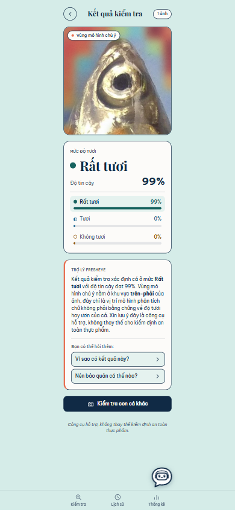
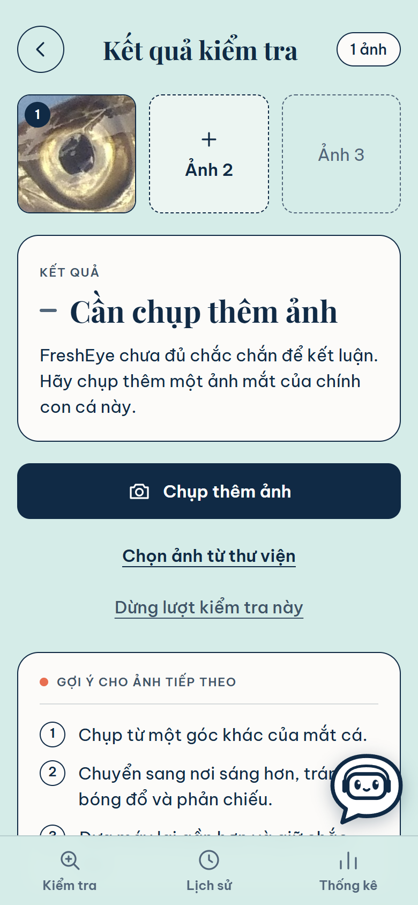
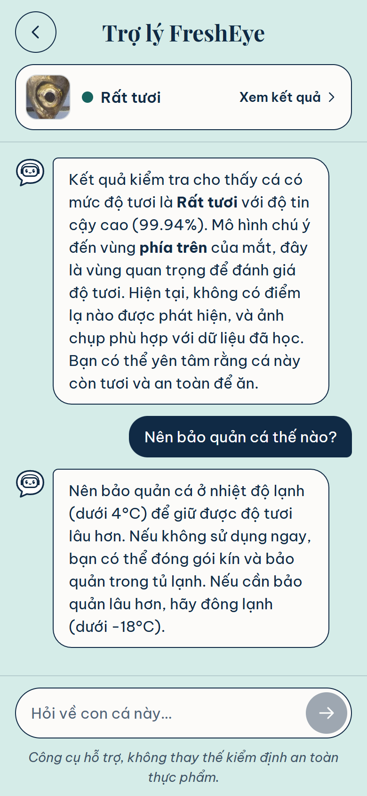
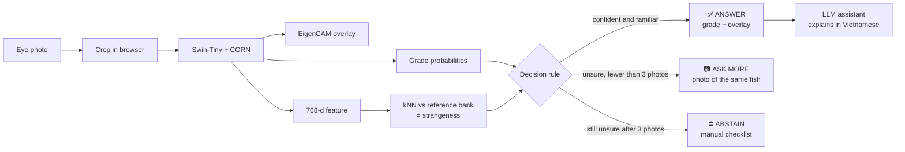
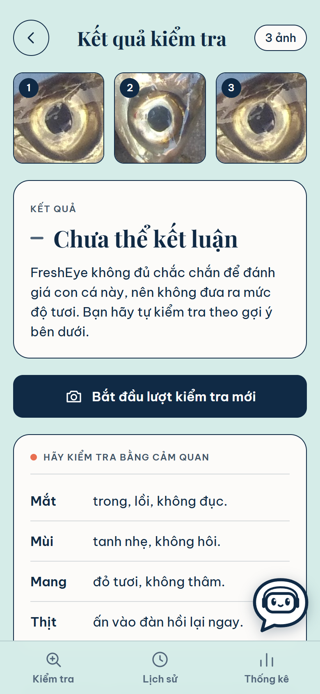
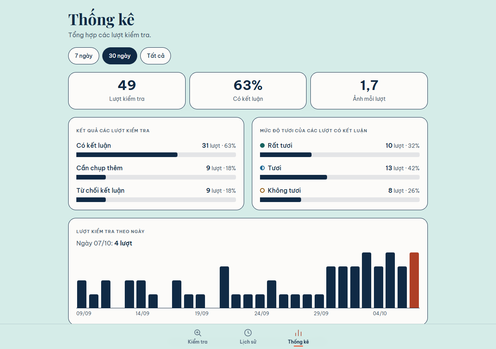

<div align="center">

# 🐟 FreshEye

**Grade fish freshness from a photo of the eye, and know when not to trust the answer.**

A mobile-first web app that grades a fish as *Highly Fresh*, *Fresh* or *Not Fresh* from eye photos,
shows where the model looked, asks for another photo when it is unsure, and refuses to answer
when the fish looks unlike anything it was trained on. An LLM assistant explains each result in Vietnamese.


[How it works](#-how-it-works) · [Features](#-features) · [Quick start](#-quick-start) · [Configuration](#%EF%B8%8F-configuration) · [Project layout](#-project-layout)


&nbsp;

&nbsp;


</div>

---

## 💡 Why

Most freshness classifiers always return a label, even for a species, a camera or lighting they
have never seen. In a market or a kitchen that is the dangerous case. FreshEye wraps a research
model in a **deterministic decision rule**: it answers only when the model is confident *and* the
photo looks familiar, otherwise it asks for more evidence or abstains and hands the user a manual
sensory checklist.

The vision model is the ordinal **Swin-Tiny + focal CORN** model from our SAMI-HUST research on
the public *Freshness of the Fish Eyes* (FFE) benchmark. This repository is the application layer
built on top of it for my graduation thesis.

## ✨ Features

- **Ordinal grading** – Swin-Tiny backbone with a CORN head decodes three ordered grades with
  rank-consistent probabilities.
- **Visual explanation** – an EigenCAM overlay shows which part of the eye drove the prediction.
- **Strangeness score** – each photo's 768-d feature is compared with a reference bank of the
  training images (mean cosine distance to the *k* nearest neighbours) to catch unfamiliar inputs.
- **Answer / ask more / abstain** – up to three photos of the same fish are pooled; a fixed rule
  on confidence and strangeness decides the outcome (see below). No LLM is involved in the decision.
- **LLM assistant** – a tool-calling agent reads the stored inspection result and answers follow-up
  questions in Vietnamese. It runs on a hosted model over any OpenAI-compatible API (Gemini,
  OpenAI, OpenRouter) or on a local model through Ollama. Only text is sent; photos never leave the server.
- **History and statistics** – every inspection is stored in SQLite and summarised on a
  dashboard by outcome, grade and day.
- **Phone-first UI** – React 19 + TypeScript + Tailwind v4, in-browser crop of the eye, built from
  a documented design system (`design/`).
- **One port in production** – FastAPI serves both the API and the built frontend.

## 🔍 How it works



Logits from all photos of one inspection are averaged before decoding, so extra photos genuinely
add evidence rather than overwrite the first one. The thresholds live in
[`backend/config/policy.json`](backend/config/policy.json) together with how each value was chosen.

<div align="center">

&nbsp;

</div>

## 🚀 Quick start

### Prerequisites

- Python 3.12 and a CUDA GPU (CPU works, slowly)
- Node.js 20.19+ (required by Vite 8)
- A trained checkpoint and its `final_config.json` (the training code is kept private until the
  paper is published)
- Either an API key for an OpenAI-compatible provider or a running [Ollama](https://ollama.com)

### 1. Backend

```bash
cd backend
python -m venv .venv && source .venv/bin/activate
pip install torch==2.12.0 torchvision==0.27.0 timm==1.0.27 numpy pillow scikit-learn \
    matplotlib fastapi "uvicorn[standard]" python-multipart httpx pytest

# put the model files where settings.json expects them (paths are relative to backend/)
mkdir -p weights && cp /path/to/final.pth /path/to/final_config.json weights/

# build the reference bank used for the strangeness score (once); it reads the image list
# release_split/development.txt, resolved next to data_dir
python scripts/build_reference_bank.py

# hosted LLM: add your key (the file is git-ignored)
cp .env.example .env   # then set LLM_API_KEY=...

uvicorn app.main:app --host 0.0.0.0 --port 8200
```

Check `GET http://localhost:8200/api/health`: it reports whether the checkpoint, config and LLM are ready.

### 2. Frontend (development)

```bash
cd frontend
npm install
npm run dev            # proxies /api and /media to http://localhost:8200
```

To use a backend on another machine, e.g. a GPU server:
`FRESHEYE_BACKEND=http://<server>:8200 npm run dev`.

### 3. Single-port production build

```bash
cd frontend && npm run build
```

Copy `frontend/dist` to a folder named `frontend_dist` next to the repository folder. On startup
the backend serves it at `/`, so the API and the UI share one port. For a split deployment
(e.g. Vercel), set your backend URL in [`frontend/vercel.json`](frontend/vercel.json).

## ⚙️ Configuration

All runtime settings are in [`backend/config/settings.json`](backend/config/settings.json):

| Setting | Meaning |
|---|---|
| `checkpoint`, `final_config` | Model weights and the config used to build the model |
| `data_dir` | Image folder used to build the reference bank |
| `app_data_dir` | Uploaded photos, CAM overlays, SQLite database, reference bank |
| `llm_provider` | `"api"` for a hosted model, `"ollama"` for a local one |
| `api_base_url`, `api_model` | Provider endpoint (without `/chat/completions`) and model name |
| `api_reasoning_effort`, `api_temperature` | Optional; `null` keeps the provider default |
| `ollama_url`, `llm_model` | Local Ollama server and model (e.g. `qwen3:8b`) |

Provider endpoints: OpenAI `https://api.openai.com/v1` · OpenRouter `https://openrouter.ai/api/v1`
· Gemini `https://generativelanguage.googleapis.com/v1beta/openai`.

## 🧪 Tests

```bash
cd backend && pytest
```

The suite covers the decision rule, strangeness scoring, EigenCAM, the database, the HTTP API,
the agent loop and the hosted-LLM client. Tests that load the model expect the checkpoint and
reference bank from the quick start to be in place. `scripts/bench_llm.py` replays scripted conversations
(`scripts/llm_scenarios.json`) to compare LLMs on tool use and answer quality.

## 📁 Project layout

```
backend/
  app/
    vision/      model loading, CORN inference, EigenCAM, strangeness
    agent/       tool-calling LLM loop, prompts, Ollama and API clients
    routers/     /api/inspections, /chat, /stats, /health
    policy.py    answer / ask more / abstain rule
  config/        settings.json, policy.json
  scripts/       reference bank, policy calibration, LLM benchmark
  tests/
frontend/
  src/pages/     capture, crop, result, ask more, abstain, assistant, history, stats
design/          design system (DESIGN.md, tokens.css) and screen mockups
```

## 🙏 Acknowledgements

- FFE dataset: *Freshness of the Fish Eyes* public benchmark.
- [timm](https://github.com/huggingface/pytorch-image-models) for the Swin Transformer backbone.
- Research carried out with the SAMI-HUST ML working group, Hanoi University of Science and Technology.

> FreshEye is a decision-support tool. It does not replace food-safety inspection.
